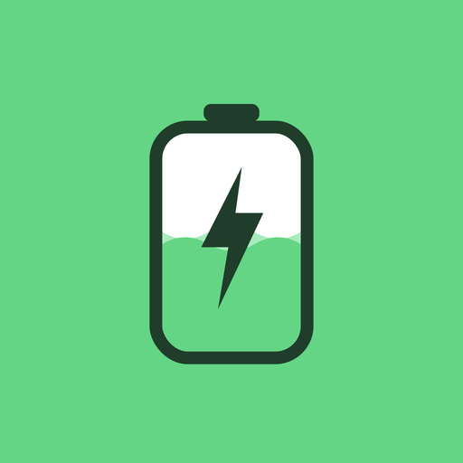
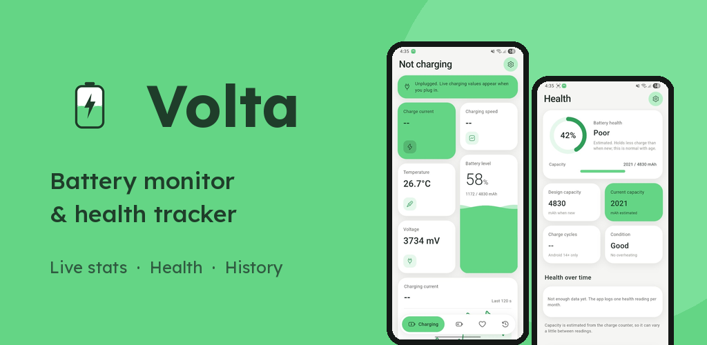
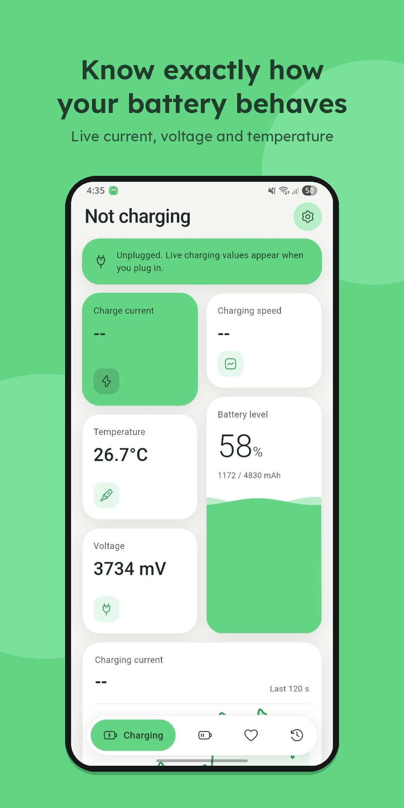
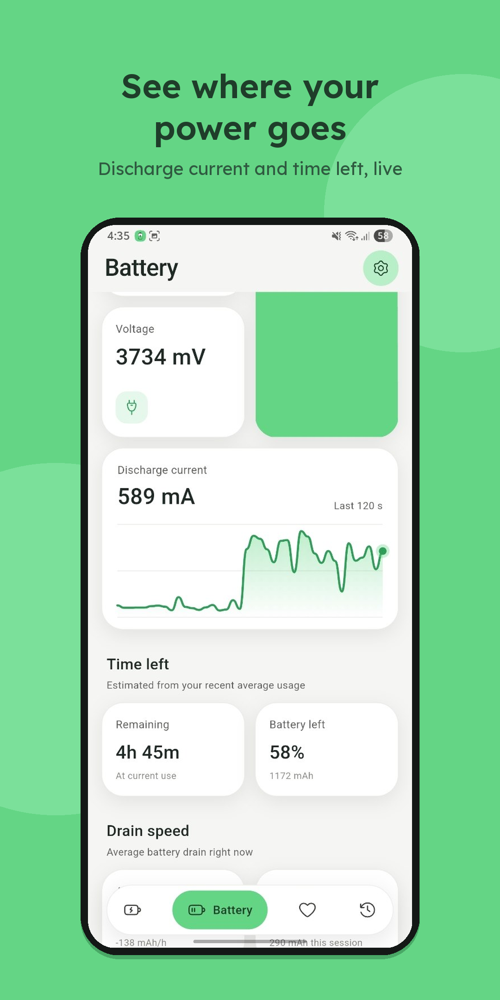
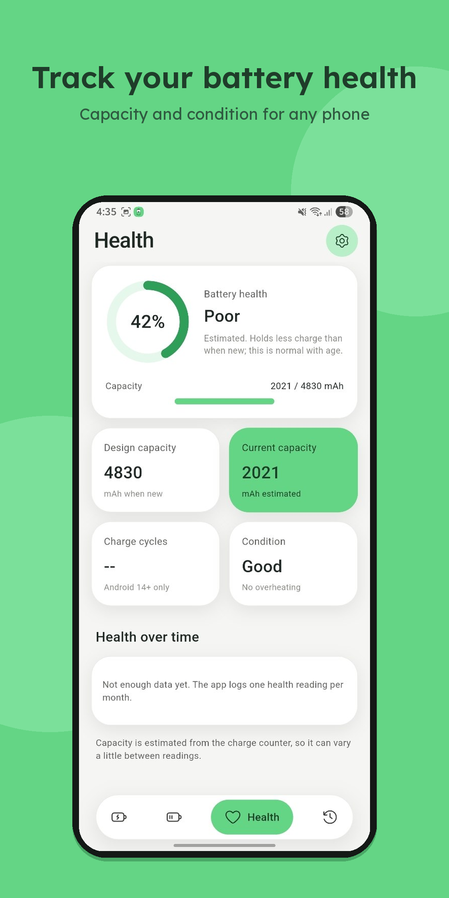
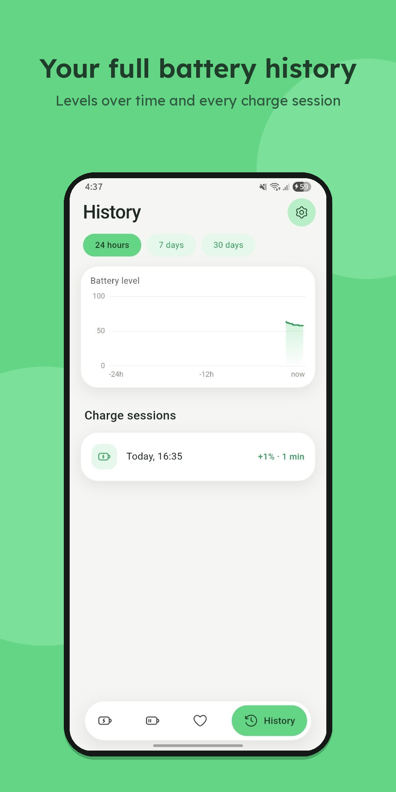

<p align="center">
  
</p>

<h1 align="center">Volta</h1>

<p align="center">
  A clean battery monitor for Android: live charge stats, battery health and history.
</p>

<p align="center">
  
</p>

---

## Screenshots

| Live dashboard | Battery | Health | History |
|:---:|:---:|:---:|:---:|
|  |  |  |  |

## Features

- **Live dashboard**: battery level with an animated fill, charge left in mAh, current in mA, power in watts, voltage and temperature.
- **Live current graph**: the last two minutes of current readings.
- **Details**: time to full charge, power source, battery condition, technology and charge cycles (where the phone reports them).
- **Battery health**: uses the value reported by the phone on Android 14 and newer when available, and estimates it from the charge counter on other phones. Estimates are labelled as estimates.
- **History**: battery level graph and a list of charge sessions.
- **No account, no sign-up.**

## How it works

Volta reads battery data straight from Android using Flutter's **direct native interop** (JNIgen), so there are no platform channels and no Kotlin code.

| Data | Android source |
|---|---|
| Battery level | `BatteryManager.BATTERY_PROPERTY_CAPACITY` |
| Charging state | `BatteryManager.isCharging` |
| Current | `BATTERY_PROPERTY_CURRENT_NOW` |
| Remaining charge | `BATTERY_PROPERTY_CHARGE_COUNTER` |
| Temperature, voltage, condition, power source, technology | `ACTION_BATTERY_CHANGED` intent extras |
| Time to full | `BatteryManager.computeChargeTimeRemaining()` |
| Health (Android 14+) | `BATTERY_PROPERTY_STATE_OF_HEALTH` (property id `10`) |
| Health (fallback) | Estimated: `chargeCounter / level / designCapacity` |

Values a phone does not report are shown as `--`, never made up.

## Tech stack

- Flutter 3.50 or newer
- [`jni`](https://pub.dev/packages/jni), [`jni_flutter`](https://pub.dev/packages/jni_flutter) and [`jnigen`](https://pub.dev/packages/jnigen) for native calls
- [`google_fonts`](https://pub.dev/packages/google_fonts) (Lexend Deca)
- [`hugeicons`](https://pub.dev/packages/hugeicons)

## Getting started

### Requirements

- Flutter 3.50 or newer
- Android SDK, with a real Android phone or an emulator
- Android only (iOS is not supported)

### Run the app

```bash
git clone <your-repo-url>
cd volta
flutter pub get
```

JNIgen needs the Android app to have been built at least once before it can generate the bindings:

```bash
flutter build apk --debug
dart run tool/jnigen.dart
flutter run
```

The generated bindings are written to `lib/android_battery.g.dart`. Run `dart run tool/jnigen.dart` again whenever you add a class to the list in `tool/jnigen.dart`.

### Build the app icon

```bash
dart run flutter_launcher_icons
```

## Project structure

```
lib/
├── android_battery.g.dart        # generated by JNIgen (do not edit)
├── core/
│   ├── model/
│   │   ├── battery_snapshot.dart # one reading of the battery
│   │   └── battery_health.dart   # health value and estimate logic
│   └── service/
│       └── battery_reader.dart   # reads battery data through JNI
├── features/
│   └── home/
│       ├── page/home_page.dart
│       └── widet/                # battery cards and graph widgets
└── main.dart
tool/
└── jnigen.dart                   # list of Android classes to generate
docs/
└── screenshots/                  # images used in this README
```

## Notes and limitations

- Battery information comes from phone hardware, so values can differ between models. Some phones report current with the opposite sign, and some do not report health or charge cycles.
- The original (design) capacity is not available to apps. It is currently set to `4830 mAh` in `home_page.dart` and should become a user setting.
- Health estimates are most accurate when the battery is at 50% or higher.
- Charge cycles and the system health value need Android 14 or newer and a phone that supports them.

## Roadmap

- [x] Live dashboard
- [x] Battery health (reported and estimated)
- [x] Live current graph
- [ ] Background recording service
- [ ] Saved history and charge sessions
- [ ] Screen on and screen off charge and drain averages
- [ ] Alerts (charge limit, low battery, overheating)
- [ ] Settings screen (design capacity, units, refresh rate)
- [ ] Onboarding

## License

Add your license here, for example MIT.
